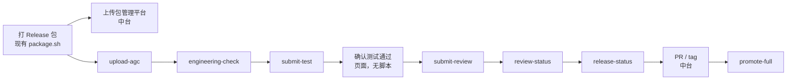

# 鸿蒙 PUBLISH 平台节点脚本建设方案

> 文档版本：V1.0  
> 更新日期：2026-11-05  
> 适用范围：牵手 HarmonyOS 正式发布 PUBLISH 场景中，交给中台调度的页面节点脚本  
> 配套文档：《鸿蒙正式发布 PUBLISH 详细建设方案》《鸿蒙 AGC 本地发布 CLI 详细建设方案》

## 1. 方案结论

`agcctl` 已经完成华为官方 API 的封装：一条命令只发起一次请求，输出一份 JSON 后退出。中台要接的不是这些原子命令，而是「平台展示节点图」上每个节点对应的一个入口脚本。

节点脚本按页面节点编排 `agcctl`，保存外部 ID，并给出该节点是否完成。中台按节点启动脚本，持久化脚本返回的任务上下文，在人工确认处暂停。节点脚本不提供 Web 页面，不部署打包机，不修改 `qianshou-harmony/scripts/package/` 里的打包脚本。

打包机上交付两个版本化安装目录：`agcctl` 发布包，以及旁边的 `publish-nodes` 脚本包。不把 `harmony-agcctl` 的 Git 工作区整份复制到打包机。

## 2. 建设边界

本次由鸿蒙侧交付：

- 第 5 节列出的节点脚本，以及 `stop-test`、`delete-test` 两个清理脚本。
- 脚本与 `agcctl` 的调用约定、任务上下文和退出码。
- 可安装到打包机的 `publish-nodes` 版本目录。

本次不交付：

| 内容 | 归属 |
|---|---|
| `package.sh`、`build_publish.sh`、`verify_artifact.sh` 等鸿蒙仓库打包脚本 | 保持现状，中台 Runner 继续调用 |
| 打包机、Web、任务库、权限、钉钉 | 中台 |
| 上传包管理平台 | 中台。协议不在本方案中定义 |
| 创建 / 合入 develop PR、创建 / 合入 master PR、创建 tag | 中台 GitHub 适配器 |
| 重写或合并 `agcctl` 命令 | `agcctl` 保持一条命令一次华为请求 |

页面节点与脚本的对应关系：



## 3. 脚本和 agcctl 的关系

三层职责分开：

| 层 | 谁运行 | 职责 |
|---|---|---|
| `agcctl` | 被节点脚本调用 | 一次华为 API。不记任务进度，不决定下一节点，不轮询到业务完成 |
| 节点脚本 | 被中台按节点调用 | 编排本节点需要的命令，处理轮询上限，把外部 ID 写回任务上下文 |
| 中台平台服务 | Web 和任务调度 | 决定何时启动哪个脚本，保存上下文，处理人工确认、钉钉、包归档、PR 和 tag |

`agcctl` 的退出码原样向上传递：

| 退出码 | 含义 | 中台处理 |
|---|---|---|
| `0` | 本次调用成功 | 看 JSON 里的 `nodeStatus` 决定节点是否完成 |
| `10` | 可重试 | 按退避重试同一脚本 |
| `20` | 不可重试 | 停止自动执行并展示错误 |
| `30` | 结果未知 | 停止后续步骤，先按本方案第 6.4 节对账 |
| `40` | 本地前提失败 | 检查产物、配置或权限 |
| `50` | 工具内部错误 | 告警后人工排查 |

`nodeStatus` 只出现在节点脚本的输出里：

| 值 | 含义 |
|---|---|
| `PASSED` | 本页面节点的完成条件已经满足 |
| `PENDING` | 华为侧仍在处理。进程已退出，中台稍后用同一上下文再调一次 |
| `FAILED` | 节点失败，任务进入对应异常状态 |

查询类节点（审核、上架、灰度）单次运行只查一次。业务未结束时退出码为 `0`，`nodeStatus` 为 `PENDING`。不要把「审核中」写成失败。工程检测和测试版本生效可以在脚本内按第 6.3 节的时间上限轮询，到点仍未完成则 `PENDING` 或超时失败，由该节写明。

## 4. 打包机上的存在形式

`agcctl` 和节点脚本都是版本化安装目录，不是开发仓库，也不是散落的几个无版本文件。

```text
/opt/qianshou-harmony/release-tools/agcctl/1.0.0/
├── bin/agcctl
├── venv/
├── app/
└── schemas/

/opt/qianshou-harmony/release-tools/publish-nodes/1.0.0/
├── bin/upload-agc
├── bin/engineering-check
├── bin/submit-test
├── bin/submit-review
├── bin/review-status
├── bin/release-status
├── bin/promote-full
├── bin/stop-test
└── bin/delete-test

/etc/qianshou-harmony/agc/
├── config.yaml
└── private.json

/srv/qianshou-harmony/artifacts/<taskId>/
/run/qianshou-harmony/agc/<taskId>/<operationKey>/
```

约定：

1. 生产调用使用版本目录的绝对路径。`current` 软链只给新任务选默认版本，运行中的任务不跟随软链切换。
2. 安装包来自发布构建，包含 `agcctl` 的虚拟环境和依赖。不包含 `.git`、测试、本地 `.venv`、开发文档和开发机上的 `config.yaml`。
3. `publish-nodes` 是独立小项目，和 `agcctl` 并列安装。多个入口共享同一套「启动 agcctl、读写任务 JSON、映射退出码」的代码。
4. `private.json` 权限 `0600`，只有发布用户可读。节点脚本不保存私钥，不在命令行参数里传递私钥、JWT 或上传签名 URL。
5. 节点脚本以参数数组启动 `agcctl`，不经过 Shell 拼接。请求文件权限 `0600`，调用结束后删除。
6. 构建 Runner 用户不能读取 Service Account。节点脚本和 `agcctl` 使用发布用户。

源代码放在 `harmony-agcctl` 仓库内、与 `src/agc_cli/` 并列的节点脚本目录，不放进 `qianshou-harmony/scripts/package/`。

## 5. 任务上下文

中台为每个 PUBLISH 任务保存一份 JSON。每次调用把这份 JSON 的路径传给节点脚本。脚本只补充本节点新产生的字段，不删已有外部 ID。

```json
{
  "schemaVersion": "1.0",
  "taskId": "PUBLISH-20261105-001",
  "toolVersion": "1.0.0",
  "appId": "<appId>",
  "artifact": {
    "path": "/srv/qianshou-harmony/artifacts/PUBLISH-20261105-001/app.app",
    "sha256": "",
    "size": 0,
    "bundleName": "com.qianshou.billionclub",
    "versionCode": 0,
    "versionName": ""
  },
  "externalIds": {
    "fileName": "",
    "objectId": "",
    "testVersionId": "",
    "testPkgId": "",
    "packageId": "",
    "publishVersionId": ""
  },
  "test": {
    "groupId": "",
    "shareLink": "",
    "releaseState": null
  },
  "release": {
    "newFeatures": "",
    "releasePhase": null,
    "releaseTime": ""
  }
}
```

五类 ID 不能混用：

| 字段 | 产生命令 | 用途 |
|---|---|---|
| `objectId` | `upload package` | 上传对象。测试选包和正式关联都用它，加上同一个 `fileName` |
| `testVersionId` | `test create-version` | AppTest 版本 |
| `testPkgId` | `test add-package` 响应里的 `pkgVersion[0]` | 工程检测时传给 `package compile-status` |
| `packageId` | `publish update-package` | 正式包。提审前的解析查询用它 |
| `publishVersionId` | 提审被接受后的正式版本查询 | 审核、灰度、转全网只认这个 ID |

`release.newFeatures`、`release.releasePhase`、`release.releaseTime` 由中台在发布负责人确认后写入。创建任务时没有这些字段。`promote-full` 还要收到中台传入的 `confirmed=true`。

## 6. 调用约定

### 6.1 中台如何启动节点脚本

```text
/opt/qianshou-harmony/release-tools/publish-nodes/1.0.0/bin/upload-agc \
  --context /srv/qianshou-harmony/operations/<taskId>/context.json \
  --agcctl /opt/qianshou-harmony/release-tools/agcctl/1.0.0/bin/agcctl \
  --config /etc/qianshou-harmony/agc/config.yaml
```

`--agcctl` 和 `--config` 使用绝对路径。脚本把 `agcctl` 的 stdout JSON 解析后，把更新过的上下文打到自己的 stdout，stderr 只写脱敏日志。

### 6.2 节点脚本如何启动 agcctl

```text
/opt/qianshou-harmony/release-tools/agcctl/1.0.0/bin/agcctl \
  upload package \
  --request-file /run/qianshou-harmony/agc/<taskId>/<operationKey>/request.json \
  --config /etc/qianshou-harmony/agc/config.yaml
```

`operationKey` 在一个任务内按操作类型唯一：

```text
<taskId>:UPLOAD_PACKAGE
<taskId>:TEST_VERSION_CREATE
<taskId>:TEST_PACKAGE_ADD
<taskId>:TEST_VERSION_UPDATE
<taskId>:TEST_VERSION_SUBMIT
<taskId>:TEST_NOTIFY
<taskId>:PUBLISH_PACKAGE_UPDATE
<taskId>:PUBLISH_LANGUAGE_UPDATE
<taskId>:PUBLISH_SUBMIT
<taskId>:PUBLISH_PROMOTE_FULL
<taskId>:APPTEST_STOP
<taskId>:APPTEST_DELETE
```

查询命令可以重复执行。创建、提交、停止、删除、转全网在退出码 `30` 或进程丢失时，先执行第 6.4 节的对账，不拿同一份请求原样重放。

### 6.3 轮询

脚本内轮询只用于有明确上限的等待：

| 等待内容 | 命令 | 节奏 | 上限 | 到点后 |
|---|---|---|---|---|
| 测试包或正式包解析 | `package compile-status` | 前 2 分钟每 10 秒，之后每 30 秒 | 20 分钟 | `nodeStatus=PENDING`，保留原包 ID，不重建草稿、不重新选包 |
| AppTest 生效且入口可用 | `test get-version` | 60 秒起，逐步降到 5 分钟 | 由中台继续调度 | `releaseState=0` 且 `shareLink` 非空才 `PASSED` |

审核、预约上架、灰度和全量不设 20 分钟失败。对应脚本每次只查询一次，返回 `PENDING`，由中台定时再调。

`package compile-status` 必须命中本次传入的包 ID。`successStatus=0` 通过，`1` 处理中，`2` 不可用。未返回目标 ID 时不能当成通过。

### 6.4 结果未知时的对账

| 未知操作 | 先调用 | 判定 |
|---|---|---|
| 上传 | 无法用现有查询唯一确认时，允许用同一文件重新 `upload package` | 新的 `objectId` 成为当前有效 ID，旧的未知对象只作废，不往下用 |
| 测试草稿、选包、提交 | `test get-version`，必要时结合已保存的 `versionId` | 已存在则补写 ID，不重复创建 |
| 正式提审 | `publish get-app-info`、`publish list-versions` | 已有本次 `versionCode` 的正式版本则补写 `publishVersionId`，不再 `publish submit` |
| 转全网 | `publish get-app-info` | 已全量则不再调用 `publish promote-full` |

## 7. 节点脚本

### 7.1 `upload-agc`：上传 AGC

调用 `upload package`。

前置条件：上下文里已有只读 APP Pack 的路径、大小和 SHA-256，且 SHA-256 与创建任务时固化的产物一致。脚本上传前再次核对文件大小和 SHA-256。

完成条件：保存 `fileName` 和 `objectId`，`nodeStatus=PASSED`。

### 7.2 `engineering-check`：工程检测

这个节点做的是 AGC 选包和包解析，不是重做打包阶段的体积、签名和加固特征检查。那些结果已经在「打 Release 包」里完成，脚本只核对上下文中的 SHA-256 仍指向同一个文件。

顺序：

1. `test create-version`，保存 `testVersionId`。
2. `test add-package`，请求只带 `fileName + objectId`，保存 `pkgVersion[0]` 为 `testPkgId`。
3. 按第 6.3 节轮询 `package compile-status`，`pkgIds` 传 `testPkgId`。

完成条件：目标包 `successStatus=0`。`successStatus=2` 为失败。超时保留 `testVersionId` 和 `testPkgId`，返回 `PENDING`。

### 7.3 `submit-test`：提交测试版本

顺序：

1. `test list-groups`，使用配置中的 QA 群组，保存 `groupId`。
2. `test update-version`，绑定 `testVersionId`、`testPkgId` 和群组。`needShareLink=1`，`needNotify=0`，`displayArea=1`。
3. `test submit-version`。提交被接受只表示进入等待生效。
4. 按第 6.3 节用 `test get-version` 查询。`releaseState` 为预审中、审核中、待生效或 `shareLink` 为空时保持 `PENDING`。
5. `releaseState=0` 且 `shareLink` 非空后，`test list-testers` 分页取成员，再 `test notify` 发官方邀请。

完成条件：官方邀请已受理，上下文中有非空 `shareLink`。钉钉由中台用这个 `shareLink` 另发，不在本脚本中调用。

### 7.4 `submit-review`：提交审核

发布资料从上下文的 `release` 读取，脚本不在创建阶段补这些字段。

顺序：

1. `publish update-package`，使用与 AppTest 相同的 `fileName + objectId`，保存正式 `packageId`。
2. 轮询 `package compile-status`，`pkgIds` 改为正式 `packageId`。
3. `publish update-language`，写入 `zh-CN` 的 `newFeatures`。
4. `publish submit`。是否先 `--dry-run` 由中台在调用参数中指定；正式发送前必须已经有发布负责人确认。
5. 提审被接受后调用 `test stop-version`。

完成条件：华为接受正式提审，上下文中有 `publishVersionId`，AppTest 停止已受理。停止失败不回滚已经接受的提审，返回可识别的清理失败，由 `stop-test` 补偿。

### 7.5 `review-status`：审核中 / 审核通过

每次运行调用 `publish get-app-info` 和 `publish list-versions`，只认 `publishVersionId`。相同 `versionCode` 的测试版本不计入正式版本。

完成条件：

- 仍在审核或预约未到上线时间：`PENDING`。
- 审核驳回：`FAILED`。
- 审核通过但尚未全网上架、也未进入灰度：节点可标记审核通过，不触发 PR。

### 7.6 `release-status`：全网上架 / 灰度中

命令与 `review-status` 相同，完成条件不同：当前正式版本已经全网上架，或已经进入灰度。返回灰度天数和比例。官方 7 天自动扩量不会等待 PR、tag 或人工确认，页面展示的是本次查询到的真实比例。

本脚本不创建 PR 或 tag。`nodeStatus=PASSED` 后，中台才开始 develop / master 两条 PR。

### 7.7 `promote-full`：确认全量

仅当请求中 `confirmed=true` 时运行。

- 当前版本仍在正常灰度：调用 `publish promote-full`，Body 为正式 `publishVersionId` 和 `releasePhase=4`。受理后返回 `PENDING`。
- 查询已经全量：不再调用转全网接口，返回 `PASSED`，并带上本次查询结果。
- 暂停、取消、版本不匹配或结果未知：失败并停止，不调用转全网。

节点最终完成还要中台自己确认包归档、两条 PR 和 tag 已经成功。本脚本只负责 AGC 侧的转全网和全量查询。

## 8. 页面之外的两个脚本

| 脚本 | 命令 | 用途 |
|---|---|---|
| `stop-test` | `test stop-version` | QA 不通过、任务取消，或提审后的停止补偿。先查询；版本已不存在则不再停止 |
| `delete-test` | `test delete-version` | 停止满 30 天后删除。失败只告警，不回退 QA 结果或正式发布状态 |

QA 在页面上暂停测试时，不调用 `stop-test`。

## 9. 交给中台的接入方式

中台按页面节点调用一个入口，不自行排列 `agcctl` 子命令。

| 中台动作 | 调用 |
|---|---|
| Release 包构建成功并固化为只读文件 | 把路径、大小、SHA-256、版本写入上下文，再启动 `upload-agc`。包管理平台用同一文件并行归档 |
| 上传成功 | 启动 `engineering-check` |
| 工程检测通过 | 启动 `submit-test` |
| 收到 `shareLink` | 发钉钉。脚本返回 `PASSED` 后等待 QA 在页面确认 |
| QA 通过，发布负责人提交资料 | 把资料写入 `release`，启动 `submit-review` |
| 提审已接受 | 定时调用 `review-status`，通过后改为定时调用 `release-status` |
| 已上架或已进灰度 | 走中台自己的 PR 和 tag。全部完成后，发布负责人确认时再调用 `promote-full` |
| 脚本返回 `PENDING` | 用同一上下文稍后重试该脚本 |
| 脚本退出码 `30` | 停止这个任务的后续变更，先对账 |

人工节点没有脚本：「确认测试通过」只存在于页面。QA 不通过时中台调用 `stop-test`，并要求修复后新建任务。

## 10. 验收

1. 中台接入一个页面节点时，只启动对应的一个节点脚本。
2. 节点脚本不调用打包脚本，不读取鸿蒙仓库里的签名密码，不修改 APP Pack。
3. `agcctl` 仍是一次命令一次华为请求；轮询发生在节点脚本或中台的再次调度里。
4. 上传、工程检测、测试提交、正式提审使用同一 SHA-256 的 APP Pack。
5. 测试 `pkgId` 与正式 `packageId` 分开保存，解析查询各自传自己的 ID。
6. 创建任务的上下文里没有新版本特性、发布方式和发布时间。这些字段只在 `submit-review` 前由中台写入。
7. `publish submit` 和 `publish promote-full` 不会被上传或 AppTest 脚本间接调用。
8. 退出码 `30` 时不会原样重放创建、提交、停止、删除或转全网。
9. 审核和灰度脚本在未完成时返回 `PENDING`，不会因为超过 20 分钟而失败。
10. 打包机上的 `agcctl` 是版本化发布目录；节点脚本在并列的 `publish-nodes/<version>/bin/` 下。私钥只在 `/etc/qianshou-harmony/agc/private.json`。
